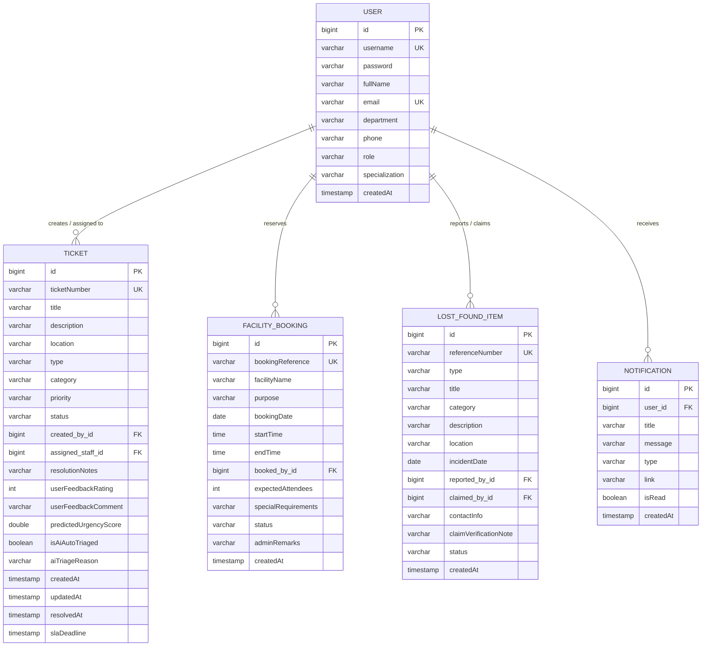

# SMART CAMPUS SERVICE & OPERATIONS PLATFORM (SmartCampus 360)
> **A Centralized Enterprise Platform for Campus Service Reporting, Conflict-Free Facility Booking, AI Automated Triage, and SLA Operations Tracking**

---

## 1. Project Overview & Abstract

The **Smart Campus Service & Operations Platform** operates as a unified operating system for higher education institutions. Rather than relying on scattered WhatsApp messages, fragmented paper requisitions, phone calls, and manual registers, students, faculty, maintenance staff, and campus administrators interact through a centralized, high-performance web platform.

### Key Value Propositions
- **Unified Single-Pane-of-Glass:** Every complaint, logistical request, or facility booking is assigned an immutable, tracked reference code (`TKT-YYYY-XXXX`, `BKG-YYYY-XXX`, `LF-YYYY-XXX`).
- **Strict Double-Booking Conflict Prevention:** A mathematical scheduling engine validates overlapping intervals (`(b.startTime < newEnd && b.endTime > newStart)`), ensuring zero double bookings for auditoriums, seminar halls, and computer laboratories.
- **Smart AI / Heuristic Auto-Triage & Predictive Maintenance:** An automated keyword and impact classification engine analyzes symptoms, assigns SLA deadlines (2h, 8h, 24h, 72h), auto-dispatches specialized technicians, and alerts administrators to recurring hardware faults.
- **Role-Based Workbenches:** Tailored dashboards for Students, Faculty, Technicians/Staff, and Administrators with a built-in client-side router.
- **1-Click Evaluation Switcher:** Specially designed for college project defense and viva demonstrations—evaluators can switch between Admin, Faculty, Student, and Technician roles with a single click.

---

## 2. System Architecture

```mermaid
graph TD
    subgraph Client Layer [Frontend Presentation Layer]
        SPA[Single Page Application - HTML5, CSS3, JS ES6+]
        Router[Hash Router: #dashboard, #tickets, #bookings, #lost-found, #analytics]
        LiveTriage[Live NLP Triage Preview Engine]
        ConflictMatrix[Visual Facility Timetable & Conflict Detector]
        Charts[Chart.js Analytics & Visual SLA Meters]
    end

    subgraph Security Layer [Spring Security & JWT]
        JwtAuth[JwtAuthenticationFilter]
        TokenProvider[JwtTokenProvider - HMAC SHA-256]
        RBAC[Role-Based Access Control: STUDENT, FACULTY, STAFF, ADMIN]
    end

    subgraph REST Controllers [Spring Boot REST API]
        AuthCtrl[AuthController - /api/v1/auth]
        TicketCtrl[TicketController - /api/v1/tickets]
        BookingCtrl[FacilityBookingController - /api/v1/bookings]
        LFCtrl[LostFoundController - /api/v1/lost-found]
        AnalyticsCtrl[AnalyticsController - /api/v1/analytics]
        TriageCtrl[SmartTriageController - /api/v1/triage]
        UserCtrl[UserController - /api/v1/users]
    end

    subgraph Service & Business Logic Layer
        TicketService[TicketService & Lifecycle Stepper]
        BookingService[FacilityBookingService & Conflict Prevention]
        TriageService[SmartTriageService - NLP & Predictive Maintenance]
        AnalyticsService[AnalyticsService & SLA Metrics]
        NotificationService[NotificationService & In-App Alerts]
    end

    subgraph Persistence Layer [Hibernate / JPA & Relational DB]
        Repos[Spring Data JPA Repositories]
        DB[(Embedded H2 / PostgreSQL Database)]
    end

    SPA -->|RESTful JSON + JWT Bearer| SecurityLayer
    SecurityLayer --> REST Controllers
    REST Controllers --> Service Layer
    Service Layer --> Repos
    Repos --> DB
```

---

## 3. Database Entity Relationship (ER) Diagram



---

## 4. Key Functional Modules

### 1. Maintenance & Operations Module
* **Categories:** Electrical (fans, lights, wiring), HVAC & AC, AV Systems (projectors, smart boards, mics), Wi-Fi & Campus Networks, Plumbing & Restrooms, Class Furniture.
* **Lifecycle Stepper:** `SUBMITTED` &rarr; `ASSIGNED` &rarr; `IN_PROGRESS` &rarr; `RESOLVED` &rarr; `CLOSED`.
* **SLA Calculation:** SLA countdown timer is generated dynamically based on severity:
  * **Critical:** 2 Hours SLA
  * **High:** 8 Hours SLA
  * **Medium:** 24 Hours SLA
  * **Low:** 72 Hours SLA
* **Resolution & Feedback:** Technicians upload resolution notes; users rate work quality (1 to 5 stars) upon resolution.

### 2. Service Requests Module
* Handles logistical campus support: auditorium chairs, PA sound setups, extension cords, podiums, lab equipment loans.

### 3. Facility Booking Engine (Strict Double-Booking Conflict Prevention)
* Validates time slots against existing reservations in real time.
* If a collision occurs:
  $$\text{Overlap Condition: } (b.\text{startTime} < \text{newEndTime}) \land (b.\text{endTime} > \text{newStartTime})$$
  The platform immediately alerts the user, locks submission, and highlights the existing conflicting event.
* Faculty reservations enjoy priority auto-approval; student club requests enter the administrative clearance queue.

### 4. Smart AI / Heuristic Triage & Predictive Maintenance
* **NLP Keyword Engine:** Scans complaint text for hazard keywords (`fire`, `spark`, `leak`, `flood`, `shock`) to elevate ticket priority.
* **Predictive Maintenance:** Detects recurring incidents (e.g. &gt; 2 complaints in the same location over 14 days) and warns administrators of underlying infrastructure wear before catastrophic failure occurs.

### 5. Lost & Found Extension
* Campus pinboard for missing belongings and found items.
* Built-in claim verification modal where rightful owners provide identifying marks before property is released.

### 6. Analytics & Operational Intelligence
* Real-time KPI counters: SLA Compliance Rate, Average Turnaround (Hours), User Satisfaction Index, Active Reservations.
* Visual Chart.js displays:
  * Maintenance Tickets by Category (Doughnut Chart)
  * Resolution Status Distribution (Bar Chart)
  * Weekly Workload Velocity & Staff Throughput (Line Chart)
  * Facility Utilization Rate (Horizontal Bar Chart)
* Instant CSV Export for administrative audit compliance.

---

## 5. Pre-Seeded Test Accounts (1-Click Login)

The platform includes a built-in demo data seeder. In the web interface, evaluators can click any of the **1-Click Evaluation Login** buttons on the login screen or use the top navigation role switcher:

| Role | Username | Password | Full Name | Capabilities |
| :--- | :--- | :--- | :--- | :--- |
| **Admin** | `admin` | `admin123` | Dr. Alok Verma | Operations Command Center, Staff Dispatch, Booking Approvals, Analytics |
| **Faculty** | `faculty` | `faculty123` | Prof. Sunita Sharma | Priority Facility Booking, Departmental Service Requests |
| **Student** | `student` | `student123` | Aarav Patel | Maintenance Reporting, Equipment Requests, Lost & Found |
| **Technician (Electrical)** | `staff_elec` | `staff123` | Rajesh Kumar | Work Order Workbench, Task Status Updates, Resolution Notes |
| **Technician (AV/Projector)** | `staff_av` | `staff123` | Vikram Singh | AV Maintenance, Projector Repairs, SLA Timers |

---

## 6. How to Run the Project

### Option A: 1-Click Launch (Recommended for Windows)
1. Double-click `run.bat` in the project root folder.
2. The batch script verifies Java 17 and boots the Spring Boot server on port `8080`.
3. Open your browser and navigate to:
   * **Web App:** [http://localhost:8080](http://localhost:8080)
   * **H2 SQL Console:** [http://localhost:8080/h2-console](http://localhost:8080/h2-console) (JDBC URL: `jdbc:h2:file:./data/smartcampusdb`, User: `sa`, Password: `password`)

### Option B: Command Line (Maven)
```bash
# Ensure Java 17 is active
java -version

# Run via Maven
mvn spring-boot:run

# Or run the pre-built JAR
java -jar target/smart-campus-platform-1.0.0.jar
```

### Option C: In Any IDE (IntelliJ IDEA / Eclipse / VS Code)
1. Open the `smart-campus` directory as a Maven project.
2. Locate `src/main/java/com/smartcampus/SmartCampusApplication.java`.
3. Right-click and select **Run 'SmartCampusApplication'**.

---

## 7. REST API Documentation

| Method | Endpoint | Description | Auth Required |
| :--- | :--- | :--- | :--- |
| `POST` | `/api/v1/auth/login` | Authenticate user & return JWT | No |
| `POST` | `/api/v1/auth/register` | Register new campus account | No |
| `GET` | `/api/v1/tickets` | Get tickets (filtered by user role) | Bearer Token |
| `POST` | `/api/v1/tickets` | Create ticket with auto-triage | Bearer Token |
| `PATCH`| `/api/v1/tickets/{id}/status`| Update status, assign staff, rate | Bearer Token |
| `POST` | `/api/v1/triage/classify`| Live NLP keyword triage preview | No |
| `GET` | `/api/v1/bookings` | Retrieve facility bookings | Bearer Token |
| `POST` | `/api/v1/bookings` | Create reservation (conflict checked)| Bearer Token |
| `GET` | `/api/v1/bookings/check-conflicts`| Query conflicting slots | Bearer Token |
| `PATCH`| `/api/v1/bookings/{id}/status`| Admin approval / rejection | Bearer (ADMIN) |
| `GET` | `/api/v1/lost-found` | List lost & found pinboard items | Bearer Token |
| `POST` | `/api/v1/lost-found` | Report missing or found item | Bearer Token |
| `POST` | `/api/v1/lost-found/{id}/claim`| Submit claim verification note | Bearer Token |
| `GET` | `/api/v1/analytics/summary` | Real-time SLA & operational metrics | No |

---

## 8. College Project Defense & Viva Q&A Guide

### Q1: Why did you choose a Single Page Application (SPA) with a custom hash router instead of multi-page JSP or Thymeleaf?
> **Answer:** An SPA architecture provides zero-reload transitions between screens, mimicking native desktop applications. The hash router (`#dashboard`, `#tickets`, `#bookings`, `#analytics`) allows deep linking while keeping all operational state responsive in memory. The backend strictly acts as a stateless RESTful service decoupled from presentation concerns.

### Q2: How does the system prevent double-booking of halls and labs?
> **Answer:** Double-booking prevention is enforced both at the database level and in the frontend controller. In `FacilityBookingRepository`, a JPQL query checks for any active reservation where:
> `(b.startTime < newEndTime AND b.endTime > newStartTime)` on the same facility and date with status `APPROVED` or `PENDING`. If an overlap is found, a `BookingConflictException` is thrown, returning an HTTP `409 CONFLICT` status code with details of the conflicting event.

### Q3: What is the "Smart Triage Engine" and how does it represent Machine Learning / heuristic intelligence?
> **Answer:** In traditional systems, priority and routing are manually chosen by the user, leading to inaccuracies. SmartCampus 360 employs a rule-based NLP parser (`SmartTriageService`) that evaluates semantic terms in the complaint text. Safety hazards (`fire`, `spark`, `leak`) immediately elevate the ticket to `CRITICAL` with a 2-hour SLA and route it to electrical/plumbing staff. Furthermore, it incorporates predictive heuristics by querying the database for repeat complaints in the same location over the past 14 days, flagging recurring equipment degradation before major breakdown occurs.

### Q4: How is security and data privacy maintained?
> **Answer:** The platform implements Spring Security 6 with stateless JWT (JSON Web Token) authentication using HMAC-SHA256 signing. User passwords are encrypted using BCrypt with salt rounds. All protected endpoints validate the Bearer token, and method security (`@EnableMethodSecurity`) enforces Role-Based Access Control (`STUDENT`, `FACULTY`, `STAFF`, `ADMIN`).
